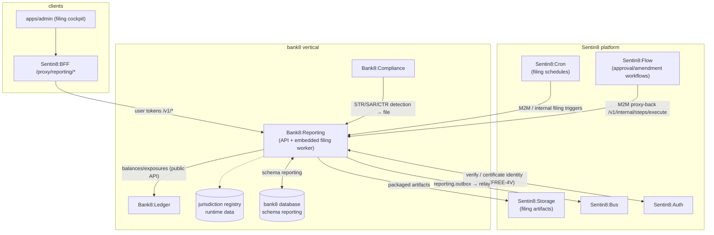

# Bank8:Reporting - README

Regulatory and prudential reporting: a filing calendar drives the
generation, packaging (XBRL/CSV), submission, and amendment of returns
to every jurisdiction's regulators - delegating timing to Sentin8:Cron,
approval/amendment workflows to Sentin8:Flow, artifact storage to
Sentin8:Storage, and money movement never touched.

## Summary

Bank8:Reporting is a Rust service owning the `reporting` schema in the
bank8 vertical database. It turns a jurisdiction-driven filing calendar
into generated returns (capital, liquidity, financial/statistical, large
exposures, granular credit), packages them in the regulator's required
format (XBRL instance documents, CSV extracts), submits them to the
configured regulator endpoint, and tracks every submission and amendment.
It is the vertical's single filing executor: AML/CTF reports (STR/SAR/
CTR/EFTR/LCTR) and sanctions reports are detected by Bank8:Compliance
but filed here.

## Motivation

Every regulator - OSFI (Canada), Fed/OCC/FDIC + FinCEN (US), ECB/EBA +
national NCAs (EU), PRA (UK) - requires the same families of returns,
differing only in thresholds, formats, cadences, and endpoints. Encoding
that per-jurisdiction variance as code would make the vertical
non-portable and hardcoded. Reporting centralizes the *filing
mechanism* (calendar → generate → package → submit → amend) once, and
drives the variance entirely from a runtime jurisdiction registry - so
a new jurisdiction is data, not engineering.

## Architecture & High-Level Design

## Key Traits and Data Structures

- `FilingCalendar` - the jurisdiction-aware schedule of due returns:
  per-regulator cadence (daily/quarterly/annual), next-due computation,
  and grace-period handling.
- `ReturnTemplate` - a declarative return definition (data sources, row
  mappings, aggregation, validation rules, output format) resolved from
  the jurisdiction registry; templates are data, never code.
- `FilingRun` - one generation/submission attempt with a guarded state
  machine (`draft → generated → validated → packaged → submitted →
  acknowledged/rejected`, with `amended`), idempotent per
  (return, period).
- `RegulatorEndpoint` - the submission target (portal URL, XBRL upload,
  SFTP) with credential references only - never plaintext secrets.

## Rationale, Trade-offs, and Alternatives

- **Single filing executor** - STR/SAR/CTR are reports too; Compliance
  detects, Reporting files. Mirrors the vertical's "one executor for
  money movement" rule (FDX detects consent, Payments executes).
- **Jurisdiction as runtime data** - the platform rule (zero hardcoded
  vertical knowledge, principles §4.14) extends to jurisdictions:
  nothing in this service names OSFI or FinCEN; the registry does.
- **Timing is Cron's, correctness is ours** - the calendar computes due
  dates; Cron fires; the workflow generates; retries are idempotent per
  (return, period). No embedded scheduler.

See `DESIGN.md` for the wire-level detail and `BUSINESS.md` for the
business capabilities.

---

**Design attribution:** bank8:reporting and its underlying concepts were designed by Hamid Jahanzad <Hamid@Jahanzad.com>.
